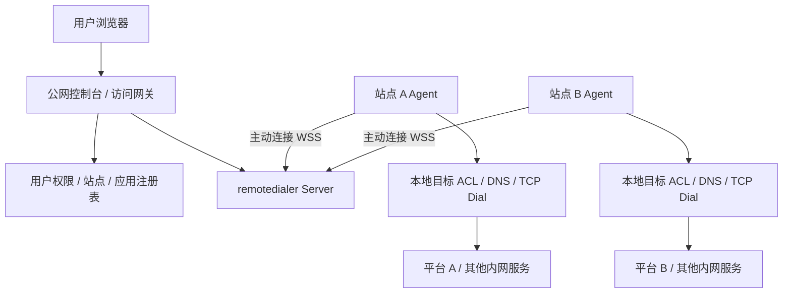

# tunnel-mvp

一个公网控制面，连接 N 个没有公网入站入口的内网数据面。用户在控制台选择站点，打开该站点的数据面平台、Grafana 或其他内网 Web 应用。

**Go 后端 + Next.js 静态前端，通过 `go:embed` 打进同一个二进制。** 运行时无需 Node.js。内网站点运行同一二进制的 `agent` 模式，只需能够主动访问公网控制面。


## 已实现

- 控制台登录、管理员 / 成员两种角色、按站点分配访问权限。
- 站点创建、在线状态、一次性展示 Agent 令牌、令牌轮换、删除与断连。
- 每站点多个 HTTP / HTTPS 应用；添加目标不需要重启 Agent，只要目标已在 Agent 白名单内。
- 每应用独立子域名、30 秒一次性登录票据、1 小时访问会话。
- 真实反向隧道、HTTP 请求与上传、WebSocket、SSE / 流式响应。
- 同源 `Location` 重写、Cookie Domain 清理、网关 Cookie 隔离、上游 Origin 与 Forwarded 头处理。
- 实际经 Agent 执行的 HTTP HEAD 探测，区分“Agent 在线”和“应用可达”。
- Agent 侧 CIDR + 端口 + 可选精确主机名白名单；内网 DNS 解析后校验 IP，并直接连接该 IP。
- HTTPS Origin 证书与 SNI 校验，系统 CA 信任；不提供跳过证书校验的开关。
- JSON 状态文件持久化与 JSONL 审计日志；密码 bcrypt、Agent 令牌 SHA-256 存储。
- Docker 多阶段构建、Compose、GitHub Actions 构建与测试。

## 架构



隧道使用 [rancher/remotedialer](https://github.com/rancher/remotedialer)，依赖固定在 `go.mod` / `go.sum`。Go `http.Transport.DialContext` 按站点选择远程 Dialer，HTTP / TLS 实际经 Agent 到达目标。所有站点使用同一个网关端口，无需逐个开放公网端口。

## 本地启动

构建需要 Go **1.27+**、Node.js **24+** 和 npm。运行产物只需要操作系统的 CA / DNS 环境。

```bash
git clone https://github.com/XUJiahua/tunnel-mvp.git
cd tunnel-mvp
make build

# 首次启动创建 admin，密码要求 12–72 字节。
# 后续启动读取 data/state.json，不会用此变量重置已有密码。
read -rs TUNNEL_ADMIN_PASSWORD
export TUNNEL_ADMIN_PASSWORD
./bin/tunnel server -config examples/server.json
```

打开 <http://localhost:8080>，使用 `admin` 和刚设置的密码登录。

1. 点击“接入新站点”，保存站点 ID 和仅展示一次的 Agent 令牌。
2. 在一个新终端中，根据接入弹窗或 `examples/agent.json` 创建 `agent.local.json`，替换 `siteID`，调整目标白名单。
3. 运行一个本地测试 Web 服务，例如 `python3 -m http.server 3000 --bind 127.0.0.1`。
4. 在 Agent 终端运行：

```bash
read -rs TUNNEL_AGENT_TOKEN
export TUNNEL_AGENT_TOKEN
./bin/tunnel agent -config agent.local.json
```

5. 在控制台添加应用，选择刚创建的站点，目标填 `http://127.0.0.1:3000`。
6. 点击“检测连接”，再点击“打开”。浏览器会访问 `http://<应用ID>.apps.localhost:8080/`。

现代 Chromium 浏览器会将 `*.localhost` 解析到回环地址。若你的浏览器 / 操作系统不支持，请在 hosts 文件中添加具体的 `<应用ID>.apps.localhost`，或使用自己配置的通配 DNS。`curl` 可用 `--resolve '<应用ID>.apps.localhost:8080:127.0.0.1'` 指定解析。

本地 HTTP 仅用于开发；Agent 仅允许通过 HTTP 连接 `localhost`、`127.0.0.1`、`::1`，其他控制面地址必须使用 HTTPS。

## Agent 白名单

```json
{
  "serverURL": "https://console.example.com",
  "siteID": "从控制台复制",
  "allow": [
    { "cidr": "127.0.0.0/8", "ports": [3000] },
    { "cidr": "10.10.0.0/16", "ports": [80, 443, 8080] },
    { "cidr": "192.168.20.0/24", "host": "grafana.internal", "ports": [3000] }
  ]
}
```

一条规则中的 CIDR、端口和可选主机名必须同时匹配，多条规则之间为“或”。`host` 是精确主机名，不支持通配符。主机名由 Agent 在内网解析，实际连接的是通过 CIDR 检查的 IP；不允许使用域名绕过网段限制。始终拒绝未指定地址、多播、链路本地地址（包括云元数据常用地址）；不支持 UDP。

每个站点一个 Agent 即可访问其网络范围内的多个目标。MVP 同一站点只接受一个活跃 Agent，重复连接返回 409。断开后使用带抖动的 1–30 秒退避自动重连。修改 Agent 白名单需要重启 Agent。

令牌由环境变量传入，不要写进命令行参数、版本库或镜像。令牌轮换会断开旧连接，旧令牌将无法重连。

## 公网部署

准备：

- `console.example.com` 指向公网控制面，用于控制台和 Agent WSS。
- `*.access.example.net` 指向相同网关，用于每个应用的独立访问域名。
- 控制面 HTTPS 证书与应用域名通配证书。
- 公网反向代理到 Go 的 8080 端口，保留原始 Host，支持 WebSocket Upgrade 和持续流式响应。

推荐控制台与应用访问域使用**不同的可注册域名**，隔离第三方应用与控制台的浏览器站点边界。应用域仅用于代理应用，不要在其下部署控制面。

修改 `examples/server.production.json`，再运行：

```bash
read -rs TUNNEL_ADMIN_PASSWORD
export TUNNEL_ADMIN_PASSWORD
docker compose up -d --build
```

Compose 默认只将 Go 的 8080 绑定到公网机器的回环地址，由宿主机 TLS 反向代理对外提供 443。数据保存在 `tunnel-data` 卷中。`examples/Caddyfile` 提供 Caddy 示例；通配证书需要自行提供，或使用包含相应 DNS Provider 模块的 Caddy 进行 DNS-01 签发。**替换配置中的示例域名后再启动。**

内网机器将 `serverURL` 设为控制面 HTTPS 地址，部署 Agent 即可，无需开放内网入站端口。若部署 Agent 容器，`127.0.0.1` 指向 Agent 容器自身；请使用实际可达地址、共享网络或宿主机网络。

私有 CA：将 CA 加入运行 Server / Agent 的系统信任库。Linux 容器也可通过 `SSL_CERT_FILE` 指定可信 CA bundle。内网应用 TLS 由 **Server** 校验，Agent 连接控制面的 TLS 由 **Agent** 校验。

## 访问与登录

访问过程：

1. 控制台用 HttpOnly、SameSite=Lax、host-only Cookie 建立 12 小时用户会话。
2. 用户点击应用，控制面检查站点权限，签发 30 秒单次票据。
3. 新标签页在应用子域名兑换 host-only 访问 Cookie，然后 303 跳转到 `/`，从地址栏移除票据。
4. 每个后续请求检查用户会话、应用 ID、站点授权，再通过远程 Dial 代理。

票据与应用 Cookie 绑定具体应用。退出控制台或删除成员会使其已有应用 Cookie 的**后续请求**失效。删除站点会删除关联应用并关闭该站点隧道；轮换令牌会关闭隧道和其中的流。

**内网应用仍使用自身的登录机制。** 控制面登录不等于自动登录 Grafana 等应用。需要免重复登录时，应另行集成共同的 OIDC 身份提供方。

应用代理兼容性：

- 优先将上游应用的 Public / External / Base URL 配为对应公网应用地址。
- 仅重写指向已配置目标源的 `Location`，不抓取或重写 HTML / JavaScript 内容。
- 不会自动代理页面硬编码的其他内部域名，也不重写跨源 OAuth 回调。OAuth 应注册公网回调地址。
- 每个应用映射到源站根路径，暂不接受带路径的目标 URL。
- 清除上游 Cookie 的 Domain，保留 Path / HttpOnly / SameSite；HTTPS 公网访问强制添加 Secure。
- 保留上游 CSP 和其他应用安全响应头，不通过 iframe 嵌入应用。
- `tunnel_console`、`tunnel_access` 为保留 Cookie 名；`/_tunnel/entry` 为保留路径。
- HTTP HEAD 探测成功代表收到了 HTTP 响应（包括 401 / 403 / 405 / 5xx），不代表业务健康。

## 数据、审计与边界

`dataDir` 保存：

| 文件 | 内容 |
| --- | --- |
| `state.json` | 用户、bcrypt 密码散列、站点、Agent 令牌散列、应用与权限 |
| `audit.jsonl` | 登录、站点 / 应用 / 用户操作、Agent 连接、应用访问与探测事件 |

状态使用互斥锁和临时文件落盘后原子替换，文件权限 0600、默认新建目录 0700。审计记录用户和资源 ID，不保存令牌、Cookie、请求体或查询参数。备份整个数据目录；审计日志由部署环境负责轮转。

**MVP 明确范围：**

- 单控制面进程、单数据目录；没有多实例共享存储、HA 或跨网关隧道路由。不要多进程同时打开同一数据目录。
- 用户 / 访问会话与短期票据在内存中，重启 Server 后需重新登录；用户、站点、服务配置保留。
- 授权在每个 HTTP 请求及 WebSocket Upgrade 时检查；用户退出后，已建立的长连接不会因会话失效自动逐个关闭。删除站点 / 轮换令牌会关闭整个站点隧道。
- 目前提供创建 / 删除成员和站点授权；修改成员授权可删除后重新创建。没有密码重置、自助改密、OIDC、MFA。
- 目标登记由管理员执行；成员不能提交任意目标地址。通过新增应用可动态访问 Agent 白名单内的新目标。
- 不支持 SSH / RDP / 数据库的浏览器协议网关，也不支持 UDP、P2P 或 QUIC。
- 每个代理请求创建独立 Transport，先保证站点与目标隔离；尚未做跨请求连接池、高并发压测或生产安全审计。
- 60 次 / 分钟全局登录限速用于 MVP；面向公网可在反向代理中另加按 IP 限速。

## 开发与验证

```bash
make build  # npm ci → Next.js 静态导出 → 复制到 embed 目录 → 编译 Go
make test   # Go race tests、go vet、Next.js TypeScript 检查

# 可选浏览器验收（先完成 make build）
cd web
npx playwright install --with-deps chromium
npm run test:e2e
```

Playwright 还覆盖控制台登录、站点注册、真实 Agent 上线、应用探测、从应用子域名登录上游、成员权限和移动端布局。GitHub Actions 会执行这条浏览器验收流程。

Go 集成测试使用真正的 Agent、WebSocket 隧道与本地 HTTP / HTTPS 源站，覆盖多站点路由与端口隔离、用户权限、票据单次兑换、Cookie 与重定向重写、WebSocket 双向数据、SSE 实时 flush、退出 / 删除成员后的拒绝、令牌轮换断连与重连、站点删除、TLS 证书拒绝和持久化。

可执行文件中已包含页面与静态资源：构建完后可单独复制 `bin/tunnel` 到其他目录运行，无需 `web/` 或 Node.js。初次编译必须执行 `make build`；直接 `go build` 而未构建前端时，控制台会返回明确的 503 提示。

```text
cmd/tunnel/           server / agent 命令入口
internal/agent/       ACL、DNS、远程 Dial 与自动重连
internal/control/     HTTP API、认证授权、隧道、应用代理、持久化
internal/config/      JSON 配置
internal/web/         go:embed 前端资源
web/                  Next.js App Router 控制台源码
scripts/embed.mjs     将静态导出复制至 Go embed 目录
examples/             本地 / 公网配置、Caddy 示例
```
