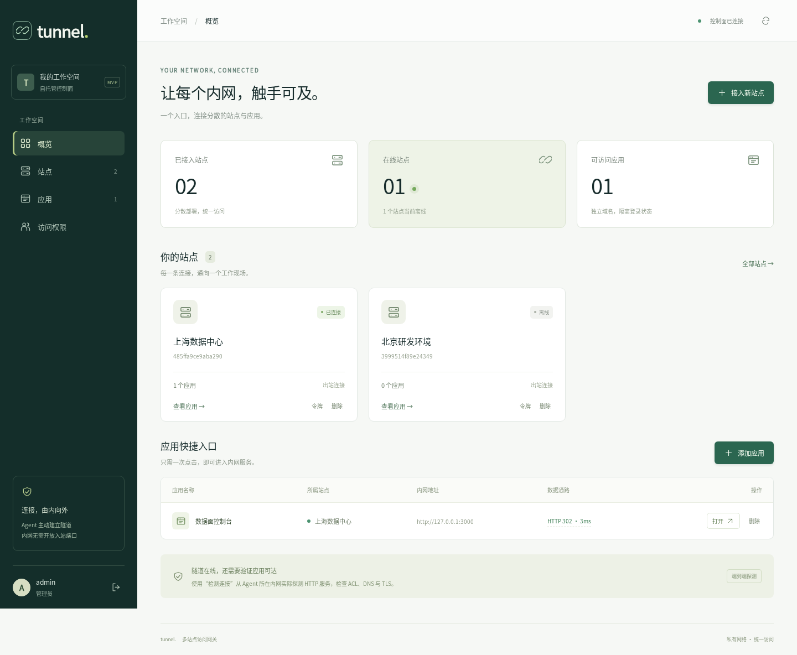
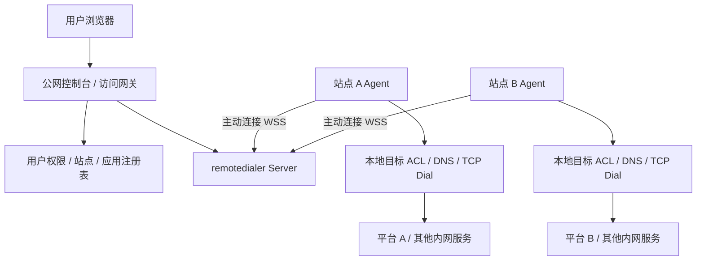

# tunnel-mvp

一个公网控制面，连接 N 个没有公网入站入口的内网数据面。用户在控制台选择站点，打开该站点的数据面平台、Grafana 或其他内网 Web 应用。

**Go 后端 + Next.js 静态前端，通过 `go:embed` 打进同一个二进制。** 运行时无需 Node.js。内网站点运行同一二进制的 `agent` 模式，只需能够主动访问公网控制面。

> 本文描述当前开发分支能力。#1–#22 的新增功能尚未进入已发布的 v0.1.1；下载旧 Release 不会获得这些功能。发布状态以 [交付基线](docs/release-readiness.md) 为准。



## 文档

- [操作手册](docs/operations.md)：升级、资源管理、权限、密码、ACL 重载、监控与备份。
- [设计说明](docs/design/operations-and-access.md)：授权语义、会话撤销、连接池隔离和兼容性。
- [存储设计](docs/design/storage.md)与[迁移/备份恢复手册](docs/storage-operations.md)：JSON / SQLite、目录锁与离线维护。
- [OIDC 设计](docs/design/oidc.md)与[统一登录/禁用手册](docs/oidc-operations.md)：显式身份绑定、Keycloak 接入和即时撤销边界。
- [会话生命周期设计](docs/design/session-lifecycle.md)与[设备/退出/恢复手册](docs/session-operations.md)：逐设备撤销、真实 Keycloak/OTP 验证和离线管理员恢复。
- [用户组/邀请设计](docs/design/groups-invitations.md)与[操作手册](docs/groups-operations.md)：共享授权、一次性链接及设密。
- [实施路线图](docs/roadmap.md)：已交付能力与已完成范围、剩余查询、HA 与目标环境验收。

- [多管理员设计](docs/design/administrators.md)与[操作手册](docs/administrator-operations.md)：独立管理员、当前密码验证与最后恢复账号保护。

- [组织与角色设计](docs/design/organizations-roles.md)与[操作手册](docs/organization-operations.md)：组织归属、自定义管理能力、隔离与角色撤销。

- [资源与路径设计](docs/design/resources-targets.md)与[迁移/域名/批量手册](docs/resource-operations.md)。

- [监控与归档设计](docs/design/monitoring-history.md)与[运维手册](docs/monitoring-operations.md)：业务健康、历史图表和配对停机备份恢复。

- [审计索引设计](docs/design/audit-index.md)与[查询手册](docs/audit-operations.md)：全部保留文件、过滤和分页；[本地依赖补丁](docs/third-party-dependencies.md)。

- [应用 OIDC 示例](examples/oidc-app/README.md)、[设计](docs/design/application-oidc.md)与[接入手册](docs/application-oidc-operations.md)：独立应用 client、路径挂载、真实 Keycloak SSO 和退出边界。

- [端到端验收矩阵](docs/e2e-acceptance.md)：截至 #22 的回归覆盖、CI 证据与未验收范围；[控制面 HA 设计提案](docs/design/control-plane-ha.md)及[故障验收手册](docs/ha-operations.md)。

- [资源定向查询设计](docs/design/resource-queries.md)与[索引操作](docs/resource-query-operations.md)：SQLite ID/域名点查、提交一致性和局部基准。

- [当前用户鉴权投影](docs/design/user-queries.md)与[查询故障手册](docs/user-query-operations.md)：直接/角色/组授权的一致读取和失败指标。

- [交付基线与后续阶段](docs/release-readiness.md)、[v0.1.1 升级与恢复](docs/upgrade-v0.1.1.md)。

## 已实现

- 控制台登录、全局管理员、组织归属、自定义组织角色及有界委派；按整站或单独应用分配访问权限；支持直接编辑成员授权、自助改密和管理员重置成员密码。
- 可选控制台 OIDC 登录（Authorization Code + PKCE），显式 issuer/sub 绑定、OIDC 专用成员、禁用/启用及即时会话撤销；保留本地管理员恢复入口。
- 站点创建、在线状态、每站点最多 16 个独立 Agent、独立凭据及故障切换；远程策略收紧、签名升级和自动回滚。
- 直接编辑站点名称、应用名称与目标地址，保留资源 ID。
- 每站点多个 HTTP / HTTPS 应用；添加目标不需要重启 Agent，只要目标已在 Agent 白名单内。
- 每应用独立子域名、30 秒一次性登录票据、1 小时访问会话。
- 真实反向隧道、HTTP 请求与上传、WebSocket、SSE / 流式响应。
- 同源 `Location` 重写、Cookie Domain 清理、网关 Cookie 隔离、上游 Origin 与 Forwarded 头处理。
- 实际经 Agent 执行的 HTTP HEAD 探测，区分“Agent 在线”和“应用可达”；失败详情含 DNS / ACL / TCP / TLS / HTTP 原因与请求 ID。
- Cobra CLI + Viper 配置文件 / 环境变量 / 参数覆盖，独立 Agent 诊断命令与 text / JSON 日志。
- Agent 侧 CIDR + 端口 + 可选精确主机名白名单；内网 DNS 解析后校验 IP，并直接连接该 IP。
- HTTPS Origin 证书与 SNI 校验，系统 CA 信任；不提供跳过证书校验的开关。
- 退出、改密、删除、收回授权及会话到期主动关闭受影响的 WebSocket / SSE / HTTP 请求。
- 登录设备列表、逐会话撤销、离线管理员恢复；OIDC back-channel/RP 退出及可选 acr/amr 策略，真实 Keycloak + OTP 双后端端到端测试。
- Agent `--watch-config` 校验后自动重载本地 ACL，通过重连撤销旧连接。
- 按应用隔离的 HTTP 连接池、可配置业务健康检查、持久化历史与图表、状态快照、Prometheus 指标与告警配置示例。
- JSON（默认）/ SQLite 状态存储、数据目录进程锁、离线迁移和带校验和的跨后端备份恢复。
- 用户组授权并集、一次性成员邀请、多管理员及最后恢复管理员保护。
- JSONL 审计日志、大小轮转、全部保留文件索引及分页；密码 bcrypt、Agent 令牌 SHA-256 存储。
- Docker 多阶段构建、Compose、GitHub Actions 构建与测试。

## 架构



隧道使用 [rancher/remotedialer](https://github.com/rancher/remotedialer)，依赖固定在 `go.mod` / `go.sum`。Go `http.Transport.DialContext` 按站点选择远程 Dialer，HTTP / TLS 实际经 Agent 到达目标。所有站点使用同一个网关端口，无需逐个开放公网端口。

## 下载二进制

从 [GitHub Releases](https://github.com/XUJiahua/tunnel-mvp/releases) 下载对应平台的压缩包，无需安装 Go 或 Node.js。当前已发布 v0.1.1 只包含初始 MVP、CLI/诊断及构建修复；本页后续功能需构建对应开发提交。

| 系统 | 架构 | v0.1.1 文件 |
| --- | --- | --- |
| Linux | amd64 / arm64 | `tunnel_0.1.1_linux_<架构>.tar.gz` |
| macOS | amd64 / arm64 | `tunnel_0.1.1_darwin_<架构>.tar.gz` |
| Windows | amd64 / arm64 | `tunnel_0.1.1_windows_<架构>.zip` |

压缩包包含二进制、README、更新说明与 `examples/`，前端已嵌入二进制；后续构建的压缩包也包含完整 docs 操作/设计手册。Linux / macOS 解压后运行 `./tunnel version`，Windows 运行 `.\tunnel.exe version`。Apple Silicon 选择 `darwin_arm64`，Intel Mac 选择 `darwin_amd64`。macOS 产物暂未签名和公证。

下载同一 Release 中的 `checksums.txt`，验证压缩包：

```bash
# Linux（只检查已下载的文件）
sha256sum --check --ignore-missing checksums.txt
# macOS（对照 checksums.txt 中对应条目）
shasum -a 256 tunnel_0.1.1_darwin_arm64.tar.gz
```

Windows 可用 `Get-FileHash .\tunnel_0.1.1_windows_amd64.zip -Algorithm SHA256` 对照校验文件。

随后参照下文配置 Server / Agent；使用下载产物时将 `./bin/tunnel` 替换为 `./tunnel`（Windows 为 `.\tunnel.exe`）。

## 本地启动

构建需要 Go **1.27+**、Node.js **24+** 和 pnpm **12.14.0**（版本固定在 `web/package.json`）。可通过 `corepack enable` 启用 pnpm。运行产物只需要操作系统的 CA / DNS 环境。

```bash
git clone https://github.com/XUJiahua/tunnel-mvp.git
cd tunnel-mvp
make build

# 首次启动创建 admin，密码要求 12–72 字节。
# 后续启动读取 data/state.json，不会用此变量重置已有密码。
read -rs TUNNEL_ADMIN_PASSWORD
export TUNNEL_ADMIN_PASSWORD
./bin/tunnel server --config examples/server.json
```

打开 <http://localhost:8080>，使用 `admin` 和刚设置的密码登录。

1. 点击“接入新站点”，保存站点 ID 和仅展示一次的 Agent 令牌。
2. 在一个新终端中，根据接入弹窗或 `examples/agent.json` 创建 `agent.local.json`，替换 `siteID`，调整目标白名单。
3. 运行一个本地测试 Web 服务，例如 `python3 -m http.server 3000 --bind 127.0.0.1`。
4. 在 Agent 终端运行：

```bash
read -rs TUNNEL_AGENT_TOKEN
export TUNNEL_AGENT_TOKEN
./bin/tunnel agent --config agent.local.json
```

5. 在控制台添加应用，选择刚创建的站点，目标填 `http://127.0.0.1:3000`。
6. 点击“检测连接”，再点击“打开”。浏览器会访问 `http://<应用ID>.apps.localhost:8080/`。

现代 Chromium 浏览器会将 `*.localhost` 解析到回环地址。若你的浏览器 / 操作系统不支持，请在 hosts 文件中添加具体的 `<应用ID>.apps.localhost`，或使用自己配置的通配 DNS。`curl` 可用 `--resolve '<应用ID>.apps.localhost:8080:127.0.0.1'` 指定解析。

本地 HTTP 仅用于开发；Agent 仅允许通过 HTTP 连接 `localhost`、`127.0.0.1`、`::1`，其他控制面地址必须使用 HTTPS。

## CLI 与配置

命令使用 [Cobra](https://github.com/spf13/cobra)，配置使用 Viper。支持 JSON / YAML，覆盖顺序为：**显式命令行参数 > 环境变量 > 配置文件 > 默认值**。旧的 `-config` 继续兼容，新命令统一使用 `--config` / `-c`。

```bash
./bin/tunnel --help
./bin/tunnel server --help
./bin/tunnel agent diagnose --help
./bin/tunnel server -c examples/server.json --check-config
./bin/tunnel agent -c agent.local.json --check-config

# 覆盖监听地址，启用结构化调试日志
./bin/tunnel server -c examples/server.json --listen 127.0.0.1:8080 --log-level debug --log-format json
./bin/tunnel agent -c agent.local.json --log-level debug --log-format json
```

`--check-config` 只校验并显示生效配置，不启动进程，不显示密码或令牌。`tunnel completion bash|zsh|fish|powershell` 生成补全脚本。

| 配置 | 环境变量 | 参数 |
| --- | --- | --- |
| 配置文件 | `TUNNEL_CONFIG` | `--config` / `-c` |
| 监听地址 | `TUNNEL_LISTEN` | `--listen` |
| 控制台地址 | `TUNNEL_PUBLIC_URL` | `--public-url` |
| 应用域地址 | `TUNNEL_ACCESS_URL` | `--access-url` |
| 状态后端 | `TUNNEL_STORAGE` | `--storage` |
| 数据目录 | `TUNNEL_DATA_DIR` | `--data-dir` |
| 自动探测间隔（秒） | `TUNNEL_PROBE_INTERVAL_SECONDS` | `--probe-interval` |
| 审计文件大小（MiB） | `TUNNEL_AUDIT_MAX_MB` | `--audit-max-mb` |
| 审计备份份数 | `TUNNEL_AUDIT_BACKUPS` | `--audit-backups` |
| 初始管理员名称 | `TUNNEL_ADMIN_USERNAME` | `--admin-username` |
| Agent 连接地址 | `TUNNEL_SERVER_URL` | `--server-url` |
| Agent 站点 | `TUNNEL_SITE_ID` | `--site-id` |
| Agent 白名单 | `TUNNEL_ALLOW`（JSON 数组） | `--allow`（JSON 数组，整组替换） |
| 日志级别 | `TUNNEL_LOG_LEVEL` | `--log-level` |
| 日志格式 | `TUNNEL_LOG_FORMAT` | `--log-format` |

配置文件也可以设置 `logLevel: debug`、`logFormat: json`。监控令牌使用 `TUNNEL_METRICS_TOKEN`（至少 32 字节），设置后启用 Bearer 认证的 `/metrics`，未设置时关闭。详见操作手册和 `examples/monitoring/`。密码与 Agent 令牌仍仅从 `TUNNEL_ADMIN_PASSWORD` / `TUNNEL_AGENT_TOKEN` 读取。

## 连接失败怎么定位

即使 Server、Agent 和应用都在同一机器上，目标也必须匹配 Agent 的**网段与端口**白名单。站点在线仅表示控制连接成功。

1. 点击应用的“检测连接”。失败会自动打开“连接诊断”，显示原因、阶段、原始错误、目标、DNS 解析 IP、每个 IP 的白名单判断与拨号结果，以及 Server / Agent 请求 ID。也可以点击“诊断详情”重新查看或复制结果。
2. 在 Agent 所在机器执行独立诊断，不需要连接控制面或提供 Agent 令牌：

   ```bash
   ./bin/tunnel agent diagnose -c agent.local.json --target http://127.0.0.1:3000
   ```

   成功输出 HTTP 状态，失败输出完整 JSON 诊断并返回非零退出码。该命令验证本机 DNS、ACL、TCP、HTTP/TLS；若本机通过而网关 TLS 失败，还需检查 Server 的 CA 信任。
3. 使用 `--log-level debug --log-format json` 启动两端，按 `request_id` / `agent_request_id` 查询日志。Agent 在默认 info 级别也会输出目标连接成功或失败；Server 会输出探测和代理错误。`audit.jsonl` 保存探测结果和请求 ID，不保存密码、令牌、Cookie、请求体或查询参数。

| 原因码 | 重点检查 |
| --- | --- |
| `site_offline` | Agent 的 Server 地址、siteID、令牌和重连日志 |
| `acl_denied` | 目标端口是否在 `allow.ports`；解析出的 IP 是否匹配 CIDR / host |
| `dns_failed` | Agent 所在网络的 DNS 配置 |
| `connection_refused` | 应用是否运行，监听 IP 与端口是否正确 |
| `network_unreachable` | 路由、防火墙、容器网络 |
| `tls_failed` | HTTP/HTTPS、证书主机名、Server 的系统 CA |
| `timeout` | 网络丢包、连接超时、应用未返回响应 |
| `http_failed` | 是否访问了 SSH 等非 HTTP 端口，或应用提前关闭连接 |

本地常见情况：

- 应用运行在 `8081`，但复制的 Agent 配置只允许 `3000`：把 `8081` 加入相应规则并重启 Agent。
- `localhost` 解析到 `::1`，应用只监听 IPv6，而白名单只允许 `127.0.0.0/8`：按实际需要显式添加 `{"cidr":"::1/128","ports":[3000]}`，或将目标与监听地址统一为 `127.0.0.1`。
- Agent 在 Docker 中而应用在宿主机：Agent 的 `localhost` 是容器自身；改用实际可达的宿主机地址，并配置相应白名单。

完整 Agent 诊断通过带站点令牌的 HTTPS/HTTP 请求上报控制面；隧道错误只携带 100 字节以内的原因码和 Agent 请求 ID，以适配 remotedialer 的限制。控制面缓存有五分钟 TTL 和 1024 条上限，并按站点隔离。上报失败或混用旧版本时会退回简短错误和日志提示，不改变隧道协议；更新 Server 和 Agent 才能获得完整诊断。

## Agent 白名单

```json
{
  "serverURL": "https://console.example.com",
  "siteID": "从控制台复制",
  "allow": [
    { "cidr": "127.0.0.0/8", "ports": [3000] },
    { "cidr": "10.10.0.0/16", "ports": [80, 443, 8080] },
    { "cidr": "192.168.20.0/24", "host": "grafana.internal", "ports": [3000] }
  ]
}
```

一条规则中的 CIDR、端口和可选主机名必须同时匹配，多条规则之间为“或”。`host` 是精确主机名，不支持通配符。主机名由 Agent 在内网解析，实际连接的是通过 CIDR 检查的 IP；不允许使用域名绕过网段限制。始终拒绝未指定地址、多播、链路本地地址（包括云元数据常用地址）；不支持 UDP。

每个站点一个 Agent 即可访问其网络范围内的多个目标。同站点可登记最多 16 个独立 Agent，分别使用 instanceID/token；旧站点令牌兼容入口只接受一个活跃连接，重复兼容连接返回 409。新 TCP 通道在在线实例间分配，故障前已发送的请求不自动重放。详见 [Agent 手册](docs/agent-operations.md)。断开后使用带抖动的 1–30 秒退避自动重连。使用 `--watch-config` 时，每 2 秒检查本地配置；合法 ACL 变更会断开旧隧道并重连，无效配置保持旧策略。未启用时需重启 Agent。身份、令牌或日志设置变更仍需重启。

令牌由环境变量传入，不要写进命令行参数、版本库或镜像。令牌轮换会断开旧连接，旧令牌将无法重连。

## 公网部署

准备：

- `console.example.com` 指向公网控制面，用于控制台和 Agent WSS。
- `*.access.example.net` 指向相同网关，用于每个应用的独立访问域名。
- 控制面 HTTPS 证书与应用域名通配证书。
- 公网反向代理到 Go 的 8080 端口，保留原始 Host，支持 WebSocket Upgrade 和持续流式响应。

推荐控制台与应用访问域使用**不同的可注册域名**，隔离第三方应用与控制台的浏览器站点边界。应用域仅用于代理应用，不要在其下部署控制面。

修改 `examples/server.production.json`，再运行：

```bash
read -rs TUNNEL_ADMIN_PASSWORD
export TUNNEL_ADMIN_PASSWORD
docker compose up -d --build
```

Compose 默认只将 Go 的 8080 绑定到公网机器的回环地址，由宿主机 TLS 反向代理对外提供 443。数据保存在 `tunnel-data` 卷中。`examples/Caddyfile` 提供 Caddy 示例；通配证书需要自行提供，或使用包含相应 DNS Provider 模块的 Caddy 进行 DNS-01 签发。**替换配置中的示例域名后再启动。**

内网机器将 `serverURL` 设为控制面 HTTPS 地址，部署 Agent 即可，无需开放内网入站端口。若部署 Agent 容器，`127.0.0.1` 指向 Agent 容器自身；请使用实际可达地址、共享网络或宿主机网络。

私有 CA：将 CA 加入运行 Server / Agent 的系统信任库。Linux 容器也可通过 `SSL_CERT_FILE` 指定可信 CA bundle。内网应用 TLS 由 **Server** 校验，Agent 连接控制面的 TLS 由 **Agent** 校验。

## 访问与登录

访问过程：

1. 控制台用 HttpOnly、SameSite=Lax、host-only Cookie 建立 12 小时用户会话。
2. 用户点击应用，控制面检查站点权限，签发 30 秒单次票据。
3. 新标签页在应用子域名兑换 host-only 访问 Cookie，然后 303 跳转到 `/`，从地址栏移除票据。
4. 每个后续请求检查用户会话、应用 ID、站点授权，再通过远程 Dial 代理。

票据与应用 Cookie 绑定具体应用。退出控制台、改密或删除成员会使相应应用 Cookie 的后续请求失效，并主动关闭受影响的长连接。收回应用授权也会关闭该应用的现有请求。删除站点会删除关联应用并关闭该站点隧道；轮换令牌会关闭隧道和其中的流。

**内网应用仍使用自身的登录机制。** 控制面登录不等于自动登录 Grafana 等应用。需要免重复登录时，应另行集成共同的 OIDC 身份提供方。

应用代理兼容性：

- 优先将上游应用的 Public / External / Base URL 配为对应公网应用地址。
- 仅重写指向已配置目标源的 `Location`，不抓取或重写 HTML / JavaScript 内容。
- 不会自动代理页面硬编码的其他内部域名，也不重写跨源 OAuth 回调。OAuth 应注册公网回调地址。
- 应用支持 origin 或相同的公网/内网路径前缀；路径目标需应用自身配置子路径，不通用改写 HTML/JS。全局管理员可绑定手工准备好 DNS/TLS 的自定义访问域名。
- 清除上游 Cookie 的 Domain，保留 Path / HttpOnly / SameSite；HTTPS 公网访问强制添加 Secure。
- 保留上游 CSP 和其他应用安全响应头，不通过 iframe 嵌入应用。
- `tunnel_console`、`tunnel_access` 为保留 Cookie 名；`/_tunnel/entry` 为保留路径。
- 默认每 60 秒自动探测（HEAD/GET，`--probe-interval 0` 可禁用），最多 4 个并发任务。HTTP 可达代表收到 HTTP 响应（包括 401 / 403 / 405 / 5xx），不代表业务健康；`healthy` 按已配置方法、路径和预期状态判断，默认接受 200–399。

## 数据、审计与边界

`dataDir` 保存：

| 文件 | 内容 |
| --- | --- |
| `state.json` / `state.db` | JSON / SQLite 后端的用户、bcrypt 密码散列、站点、Agent 令牌散列、应用与权限 |
| `audit.jsonl` 及轮转文件 | 登录、资源 / 权限操作、Agent 连接、应用访问与探测事件 |
| `monitor.db` | 健康历史与可重建的审计索引；与授权状态分开配对备份 |

默认 JSON 使用临时文件落盘后原子替换；可显式选择 SQLite，以事务与外键保存配置。新文件权限 0600、默认新建目录 0700。目录锁阻止两个新版本进程并发使用同一数据目录。审计记录用户和资源 ID，不保存令牌、Cookie、请求体或查询参数。备份整个数据目录；审计默认每 20 MiB 轮转、保留 5 份，可配置；控制台索引全部保留审计文件并提供过滤与分页。已被轮转删除的历史需使用事先归档或外部日志系统查询。

切换后端前先停止 Server，执行 `tunnel storage migrate --data-dir data`，再设置 `storage: sqlite`。`storage export/validate/restore` 支持两后端之间的可移植备份。迁移保留原 JSON，拒绝覆盖已有 SQLite；细节见存储手册。

**当前版本边界：**

- 单控制面进程、单数据目录；没有多实例共享存储、HA 或跨网关隧道路由。新版本会拒绝第二个进程打开同一数据目录；不要使用多主机共享文件系统。SQLite 不提供控制面 HA。
- 用户 / 访问会话与短期票据在内存中，重启 Server 后需重新登录；用户、站点、服务配置保留。
- 授权在每个 HTTP 请求及 WebSocket Upgrade 时检查；退出、密码变更、授权收回或到期主动关闭受影响的请求。删除站点 / 轮换令牌会关闭整个站点隧道。
- 已支持成员授权编辑、自助改密和管理员重置成员密码；支持显式 OIDC 绑定与账号禁用；已支持离线管理员恢复、OIDC back-channel/RP 退出和可选 acr/amr 策略；支持用户组与一次性成员邀请；已支持组织隔离、自定义管理角色和有界委派；单成员仍只属于一个组织，尚无组织级 IdP。
- 目标登记由全局管理员或具有组织应用管理能力的成员执行；普通访问成员不能提交任意目标地址。通过新增应用可动态访问 Agent 白名单内的新目标。
- 不支持 SSH / RDP / 数据库的浏览器协议网关，也不支持 UDP、P2P 或 QUIC。
- 连接池按应用隔离并在 Agent 断线/目标修改时清理；已验证真实隧道连接复用。尚未进行生产容量压测或生产安全审计；可选 session 连接模式已验证身份隔离；真实 AD/NTLM 产品仍需单独验收。
- 本地密码登录为 60 次 / 分钟全局限速，OIDC pending flow 上限 256 条/5 分钟；这些限制用于 MVP；面向公网可在反向代理中另加按 IP 限速。

## 开发与验证

```bash
make build  # pnpm install --frozen-lockfile → Next.js 静态导出 → 复制到 embed 目录 → 编译 Go
make test   # Go race / vet、双后端控制面、TypeScript、发布标签保护检查

# 可选浏览器验收（先完成 make build）
cd web
pnpm exec playwright install --with-deps chromium
pnpm run test:e2e
```

Playwright 还覆盖控制台登录、站点注册、真实 Agent 上线、应用探测、从应用子域名登录上游、成员权限和移动端布局。GitHub Actions 会执行这条浏览器验收流程。

Go 集成测试使用真正的 Agent、WebSocket 隧道与本地 HTTP / HTTPS 源站，覆盖多站点路由与端口隔离、用户权限、票据单次兑换、Cookie 与重定向重写、WebSocket 双向数据、SSE 实时 flush、退出 / 删除成员后的拒绝、令牌轮换断连与重连、站点删除、TLS 证书拒绝和持久化。

可执行文件中已包含页面与静态资源：构建完后可单独复制 `bin/tunnel` 到其他目录运行，无需 `web/` 或 Node.js。初次编译必须执行 `make build`；直接 `go build` 而未构建前端时，控制台会返回明确的 503 提示。

```text
cmd/tunnel/           server / agent 命令入口
internal/agent/       ACL、DNS、远程 Dial 与自动重连
internal/control/     HTTP API、认证授权、隧道、应用代理
internal/state/       Repository、JSON/SQLite、目录锁、迁移与备份恢复
internal/config/      JSON 配置
internal/web/         go:embed 前端资源
web/                  Next.js App Router 控制台源码
scripts/embed.mjs     将静态导出复制至 Go embed 目录
examples/             本地 / 公网配置、Caddy 示例
```

## 发布新版本

`.goreleaser.yaml` 固定六个平台矩阵，`CGO_ENABLED=0` 交叉编译。发布前钩子先执行 `make frontend`，确保每个平台都嵌入同一份 Next.js 静态资源。GoReleaser 注入版本、提交 SHA 与构建时间；Linux / macOS 输出 tar.gz，Windows 输出 zip，并生成 SHA-256 校验文件。

正常发布：先完成 [交付检查](docs/release-readiness.md)，再对验收过的准确提交推送版本标签，CI 检查通过后创建 GitHub Release 并上传产物。以下命令是操作示例，不代表该版本已发布。

```bash
git tag -a v0.2.0 -m "Release v0.2.0"
git push origin v0.2.0
```

也可在 Actions → release → Run workflow 中选择要发布的代码引用并填写 `tag`，CI 在检查通过后创建缺失的标签。标签存在时必须指向当前所选提交，工作流不会移动已有标签。重试旧版本时选择该版本标签作为工作流引用，或使用 GitHub Actions 的失败任务重跑功能。

首次 `v0.1.0` 由 `publish-v0.1.0.yml` 的一次性入口调用同一个发布工作流；已发布后会跳过。因为 `GITHUB_TOKEN` 推送的标签不会触发新的工作流，首次发布在同一 CI 调用中完成打包与上传。

CI 会先执行构建、Go race / vet、TypeScript 与真实 Agent 的 Playwright 测试，再由 GoReleaser 上传到草稿 Release。CI 校验六个平台矩阵、SHA-256、压缩包完整性与必要文件，再下载附件重新校验，全部通过后公开发布。仅发布工作流具有 `contents: write` 权限；普通构建保持只读，不需要额外 PAT。

本地验证需要安装 GoReleaser **v2.17.1**、Python **3.11+** 和前述 Go / Node.js：

```bash
make release-check
make release-snapshot
```

本地和 CI 固定使用 GoReleaser v2.17.1，`make release-check` 检查版本与配置。

快照包输出到 `dist/`，不创建远端标签、不上传 Release。生产包由 CI 的 `goreleaser release --clean` 生成。

Agent 多实例：[设计](docs/design/agent-instances.md) · [登记、切换和凭据操作](docs/agent-operations.md)。

Agent 远程收紧策略：[设计](docs/design/agent-remote-policy.md) · [配置与故障操作](docs/agent-policy-operations.md)。

Agent 签名升级：[设计](docs/design/agent-updates.md) · [发布、主机配置与回滚](docs/agent-update-operations.md)。

连接身份隔离与容量：[设计](docs/design/session-pools.md) · [操作](docs/connection-mode-operations.md) · [实测报告](docs/capacity-report.md)。

组织角色委派：[设计](docs/design/delegated-roles.md) · [操作](docs/delegated-role-operations.md)。

SQLite 增量持久化：[设计](docs/design/incremental-sqlite.md) · [操作与写入基准](docs/sqlite-incremental-operations.md)。

审计增量轮转：[设计](docs/design/audit-rotation.md) · [升级与故障操作](docs/audit-rotation-operations.md)。

Keycloak 禁用自动撤销：[设计](docs/design/keycloak-session-sync.md) · [配置与演练](docs/keycloak-sync-operations.md)。
